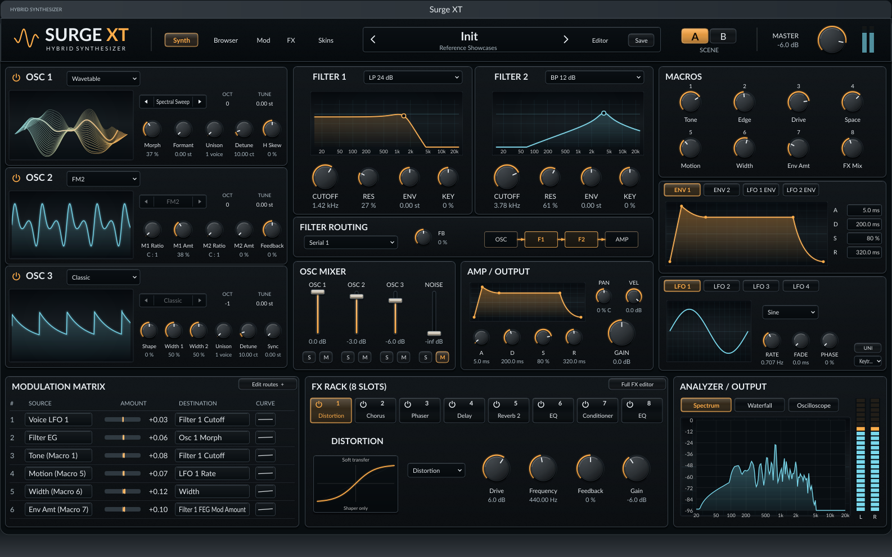
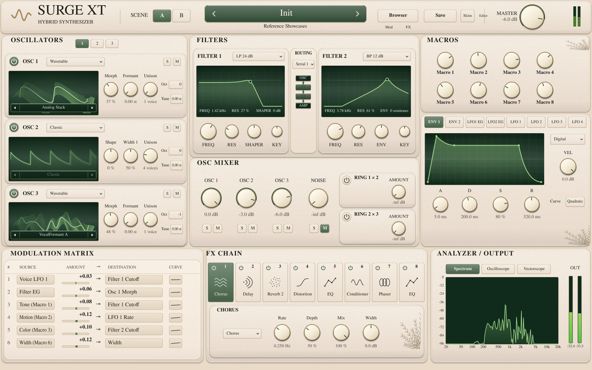
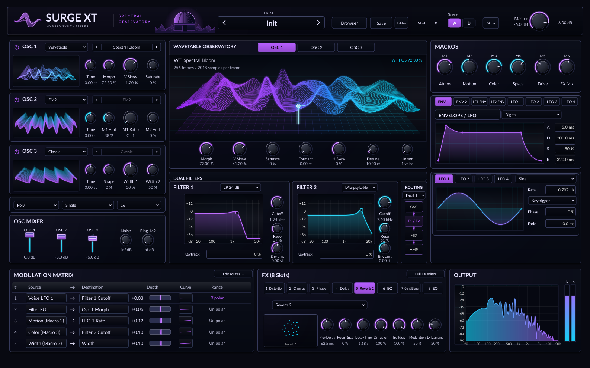
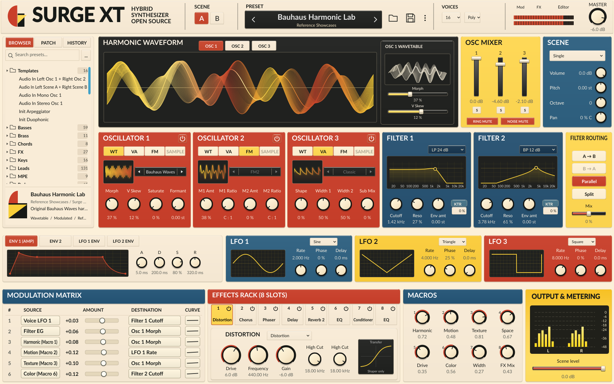
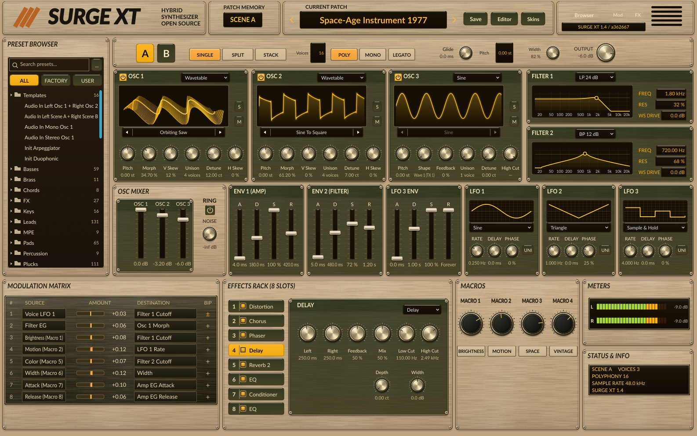
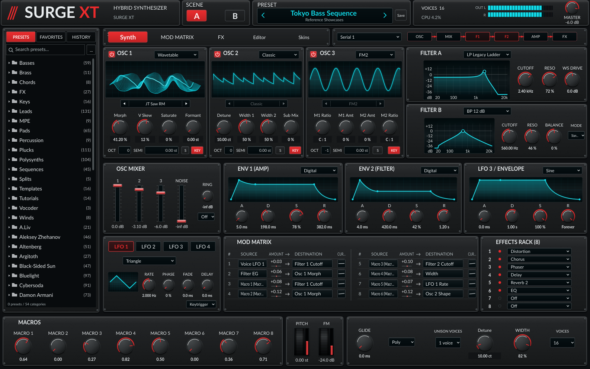
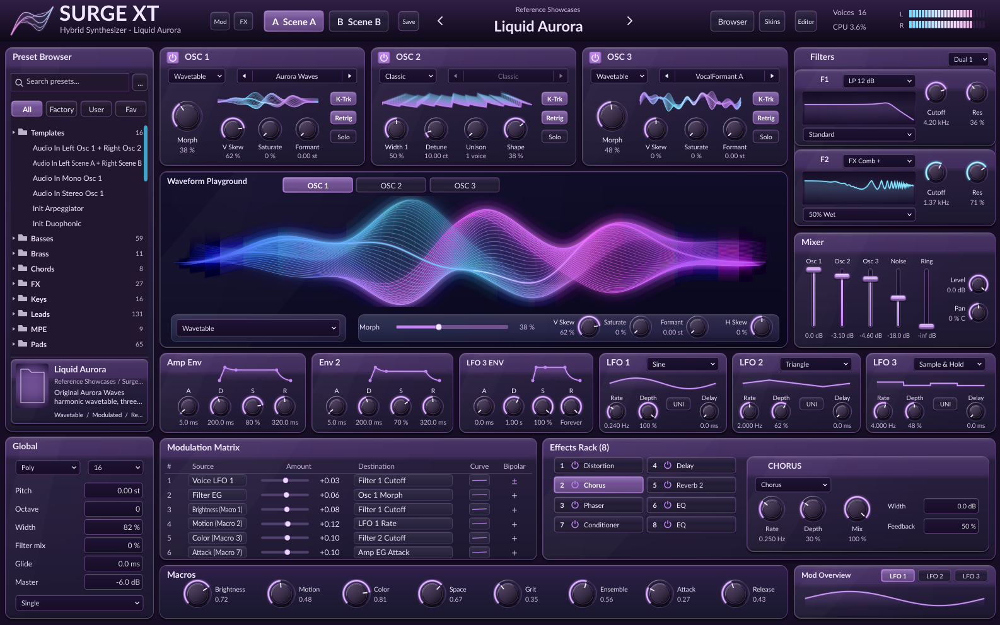
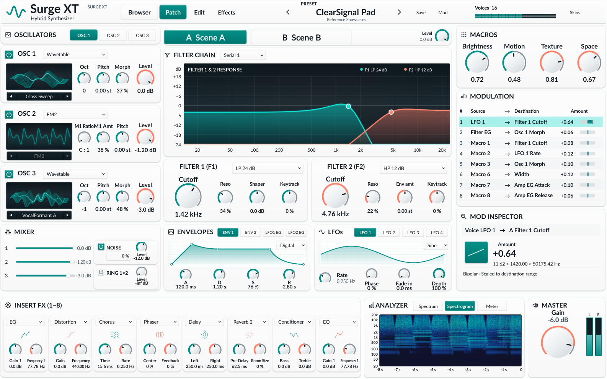
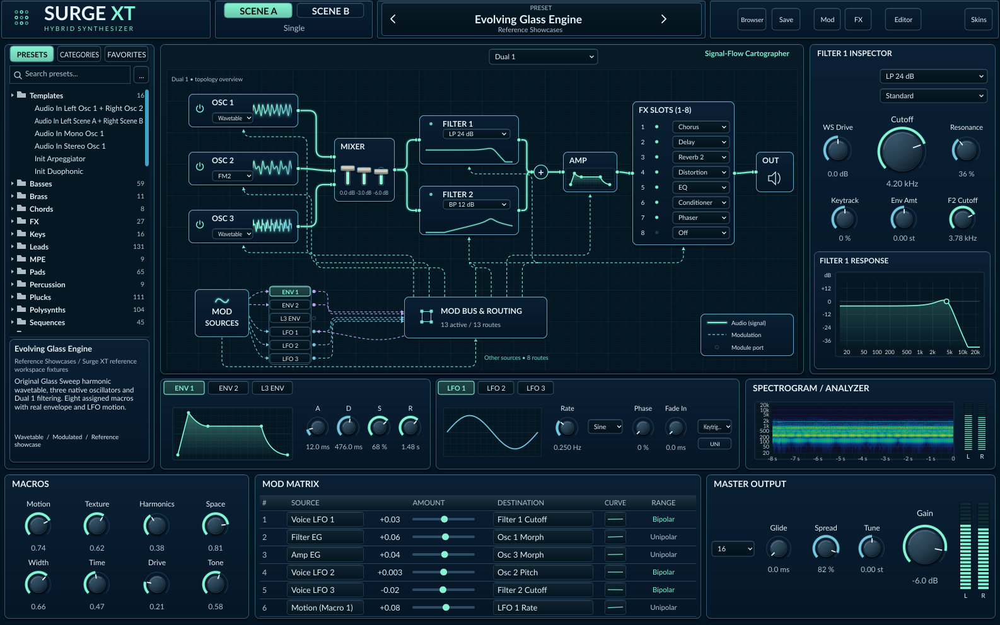
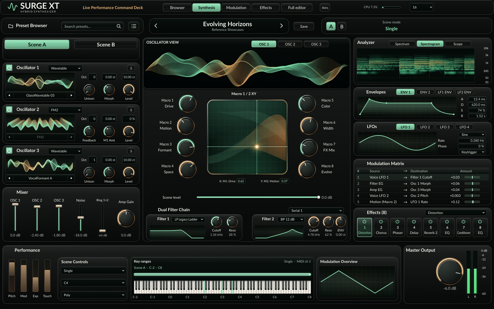

# Surge XT

## This fork: Scoring 1000 factory bank

**Scoring 1000 adds 1,000 original, self-contained FXP presets in ten categories**:
Keys, Plucks, Bells and Mallets, Pads, Ensemble Hybrids, Drones and Air, Bass,
Leads, Pulses and Sequences, and Percussion and Transitions. The collection uses
200 authored families with five functional variants each, with consistent
Tone, Motion, Contour, Space, Color, Width, Attack and Release macros.

Every native engine build embeds the complete bank and all ten reference skin
packages in a **190,454-byte compressed payload**. They appear under
**Scoring 1000** in the factory browser and **Reference Workspaces** in the skin
menu, including plugin-only distributions. A matching full installation is
reused; otherwise the application automatically prepares about 35 MB of private
factory cache from its own binary. No separate preset download, samples, or
wavetables are required for this collection. See the
[built-in content design and verification](doc/scoring-1000/BUILT_IN_CONTENT.md).

Get this fork's synth binaries from the
[platform build downloads](doc/scoring-1000/BUILT_IN_CONTENT.md#build-downloads).
The guide identifies each platform artifact, package choices, and macOS signing
status for the verified source revision.

Read the [composer research](doc/scoring-1000/RESEARCH.md),
[player and genre guide](doc/scoring-1000/USER_GUIDE.md), and
[native QA protocol](scripts/scoring/QA_RUNNER.md).
Browse the [200-family catalog](doc/scoring-1000/CATALOG.md) for every preset ID,
musical role, suggested range and variant.
Listen to the [native audio previews](doc/scoring-1000/AUDIO_PREVIEWS.md),
including one example from each category and a compact overview.
All 1,000 current presets passed 23,000 primary native-engine scenarios and five
technical gates each, plus 2,000 prolonged held-note fixtures. All 8,000 macro
responses are resolved, with no protocol warnings. The
[complete technical evidence](doc/scoring-1000/evidence/README.md) includes the
original per-preset reports, exact input hashes and measurement limits.
Technical measurements do not certify human musical audition, acoustic realism,
composer endorsement, or suitability for every cue.

The factory bank and embedded content are checked at configure, build and
packaging time for exact counts, paths and matching SHA-256 hashes. The
[Scoring 1000 native workflow](https://github.com/tomasedisonn80/surgeXT-synth/actions/workflows/scoring-native.yml)
rebuilds the actual offline engine, verifies staged discovery, and supports a full-bank run.

## This fork: ten native reference workspaces

This fork adds ten alternative, interactive Surge XT layouts selected through
**Settings → Skins → Reference Workspaces**. They require this fork's modified
native build; installing their JSON/skin files into ordinary upstream Surge XT
does not install the renderer. The original full editor remains available.

Browse the [native screenshot gallery](doc/reference-workspaces/native-gallery/README.md)
for all ten skins, with separate reference and edited-state comparisons. The
[current fidelity record](doc/reference-workspaces/fidelity-2026-11-13/README.md)
links the ten-wave assignment ledger and exact build/capture evidence.

See the [installation and controls guide](doc/reference-workspaces-user-guide.md),
[engineering work log](doc/reference-workspaces-work-log.md), and
[native build/capture workflow](https://github.com/tomasedisonn80/surgeXT-synth/actions/workflows/reference-workspaces.yml).
The layouts follow supplied design references, with explicit engine adaptations;
neither pixel identity nor release certification is implied by a source checkout.

## Latest native UI/UX redesign screenshots

All ten layouts below are from the [latest verified native capture run](https://github.com/tomasedisonn80/surgeXT-synth/actions/runs/43573848463),
using the actual Surge XT processor at **1586 × 992**. Click any screenshot to
open its full-resolution PNG. Each skin also links to its real edited state and
the original design reference. The [complete comparison gallery](doc/reference-workspaces/native-gallery/README.md)
contains capture evidence and image hashes.

| **01 · Obsidian Precision** | **02 · Ivory Atelier** |
| :---: | :---: |
| [](doc/reference-workspaces/native-gallery/01-obsidian-precision.png) | [](doc/reference-workspaces/native-gallery/02-ivory-atelier.png) |
| [Edited state](doc/reference-workspaces/native-gallery/01-obsidian-precision-edited.png) · [Reference](doc/reference-workspaces/references/01_Obsidian_Precision.png) | [Edited state](doc/reference-workspaces/native-gallery/02-ivory-atelier-edited.png) · [Reference](doc/reference-workspaces/references/02_Ivory_Atelier.png) |
| **03 · Spectral Observatory** | **04 · Bauhaus Modular** |
| [](doc/reference-workspaces/native-gallery/03-spectral-observatory.png) | [](doc/reference-workspaces/native-gallery/04-bauhaus-modular.png) |
| [Edited state](doc/reference-workspaces/native-gallery/03-spectral-observatory-edited.png) · [Reference](doc/reference-workspaces/references/03_Spectral_Observatory.png) | [Edited state](doc/reference-workspaces/native-gallery/04-bauhaus-modular-edited.png) · [Reference](doc/reference-workspaces/references/04_Bauhaus_Modular.png) |
| **05 · Space-Age 1977** | **06 · Tokyo Industrial** |
| [](doc/reference-workspaces/native-gallery/05-space-age-1977.png) | [](doc/reference-workspaces/native-gallery/06-tokyo-industrial.png) |
| [Edited state](doc/reference-workspaces/native-gallery/05-space-age-1977-edited.png) · [Reference](doc/reference-workspaces/references/05_Space_Age_1977.png) | [Edited state](doc/reference-workspaces/native-gallery/06-tokyo-industrial-edited.png) · [Reference](doc/reference-workspaces/references/06_Tokyo_Industrial.png) |
| **07 · Liquid Aurora** | **08 · ClearSignal Accessible** |
| [](doc/reference-workspaces/native-gallery/07-liquid-aurora.png) | [](doc/reference-workspaces/native-gallery/08-clearsignal-accessible.png) |
| [Edited state](doc/reference-workspaces/native-gallery/07-liquid-aurora-edited.png) · [Reference](doc/reference-workspaces/references/07_Liquid_Aurora.png) | [Edited state](doc/reference-workspaces/native-gallery/08-clearsignal-accessible-edited.png) · [Reference](doc/reference-workspaces/references/08_ClearSignal_Accessible.png) |
| **09 · Signal-Flow Cartographer** | **10 · Live Performance Deck** |
| [](doc/reference-workspaces/native-gallery/09-signal-flow-cartographer.png) | [](doc/reference-workspaces/native-gallery/10-live-performance-deck.png) |
| [Edited state](doc/reference-workspaces/native-gallery/09-signal-flow-cartographer-edited.png) · [Reference](doc/reference-workspaces/references/09_Signal_Flow_Cartographer.png) | [Edited state](doc/reference-workspaces/native-gallery/10-live-performance-deck-edited.png) · [Reference](doc/reference-workspaces/references/10_Live_Performance_Deck.png) |

The upstream project documentation follows below.

**If you are a musician looking to use Surge XT, please download the appropriate binary
[from our website](https://surge-synthesizer.github.io). Surge Synth Team makes regular releases for all supported
platforms.**

CI: [](https://dev.azure.com/surge-synthesizer/surge/_build/latest?definitionId=2&branchName=main)
Release: [](https://dev.azure.com/surge-synthesizer/surge/_build/latest?definitionId=1&branchName=master)
Release-XT: [](https://dev.azure.com/surge-synthesizer/surge/_build/latest?definitionId=13&branchName=master)

Surge XT is a free and open-source hybrid synthesizer, originally written and sold as a commercial product by @kurasu/Claes
Johanson at [Vember Audio](http://vemberaudio.se). In September 2018, Claes decided to release a partially completed
version of Surge 1.6 under GPL3, and a group of developers have been improving it since. You can learn more about the
team at https://surge-synth-team.org/ or connect with us
on [Discord](https://discord.gg/spGANHw)
.

If you would also like to participate in discussions, testing and design of Surge XT, we have details below.

This readme serves as the root of developer documentation for Surge XT.

# Developing Surge XT

We welcome developers! Our workflow revolves around GitHub issues in this repository and conversations at our Discord
server. You can read our developer guidelines
in [our developer guide document](doc/Developer%20Guide.md). If you want to contribute and are new to Git, we also have
a [Git How To](doc/How%20to%20Git.md), tailored at Surge XT development.

The developer guide also contains information about testing and debugging in particular hosts on particular platforms.

Surge XT uses CMake for all of its build-related tasks, and requires a set of free tools to build the synth. If you have
a development environment set up, you almost definitely have what you need, but if not, please check out:

- [Setting up Build Environment on Windows](#windows)
- [Setting up Build Environment on macOS](#macos)
- [Setting up Build Environment on Linux](#linux)

Once you have set your environment up, you need to checkout the Surge XT code with Git, grab submodules, run CMake to
configure, then run CMake to build. Your IDE may support CMake (more on that below), but a reliable way to build Surge XT
on all platforms is:

```
git clone https://github.com/surge-synthesizer/surge.git
cd surge
git submodule update --init --recursive
cmake -Bbuild -DCMAKE_BUILD_TYPE=Release
cmake --build build --config Release --target surge-staged-assets
```

(Replace `Release` with `Debug` or `RelWithDebInfo` consistently in both lines as you need.)

This will build all the Surge XT binary assets in the directory `build/surge_xt_products` and is often enough of a formula
to do a build.

> [!TIP]
> To only build the VST3, replace the above final command with this:
```bash
cmake --build build --config Release --target surge-xt_VST3
```

## Developing from your own fork

Our [Git How To](doc/How%20to%20Git.md) explains how we are using Git. If you want to develop from your own fork, please
consult there, but the short version is (1) fork this project on GitHub and (2) clone your fork, rather than the main
repo as described above. So press the `Fork` button here and then:

```
git clone git@github.com:youruserid/surge.git
```

and the rest of the steps are unchanged.

## Building projects for your IDE

When you run the first CMake step, CMake will generate IDE-compatible files for you. On Windows, it will generate Visual
Studio files. On Mac it will generate makefiles by default, but if you add the argument `-GXcode` you can get an XCode
project if you want.

Surge XT developers regularly develop with all sorts of tools. CLion, Visual Studio, vim, emacs, VS Code, and many others
can work properly with the software.

## Building a VST2

Due to licensing restrictions, VST2 builds of Surge XT **may not** be redistributed. However, it is possible to build a
VST2 of Surge XT for your own personal use. First, obtain a local copy of the VST2 SDK, and unzip it to a folder of your
choice. Then set `VST2SDK_DIR` to point to that folder:

```
export VST2SDK_DIR="/your/path/to/VST2SDK"
```

or, in the Windows command prompt:

```
set VST2SDK_DIR=c:\path\to\VST2SDK
```

Finally, run CMake afresh and build the VST2 targets:

```
cmake -Bbuild_vst2
cmake --build build_vst2 --config Release --target surge-xt_VST --parallel 4
cmake --build build_vst2 --config Release --target surge-fx_VST --parallel 4
```

You will then have VST2 plugins in `build_vst2/surge-xt_artefacts/Release/VST`
and  `build_vst2/surge-fx_artefacts/Release/VST` respectively. Adjust the number of cores that will be used for building
process by modifying the value of `--parallel` argument.

## Building with support for ASIO

On Windows, building with ASIO is often preferred for Surge XT standalone, since it enables users to use the ASIO
low-latency audio driver.

We are grateful to Steinberg Media Technologies for updating their licensing to include GPL3 as an option,
which allows us to effortlessly provide ASIO support _out of the box_, without any special build procedures required.

## Building an LV2

Surge XT 1.3 family moves to JUCE 7, which includes support for LV2 builds. For a variety of reasons
we don't build LV2 either by default or in our CI pipeline. You can activate the LV2 build in your
environment by adding `-DSURGE_BUILD_LV2=TRUE` on your initial CMake build.

## Building and Using the Python Bindings

Surge XT uses `pybind` to expose the innards of the synth to Python code for direct
native access to all its features. This is a tool mostly useful for developers,
and the [surge-python](https://github.com/surge-synthesizer/surge-python)
repository shows some uses.

To use Surge XT in this manner, you need to build the Python extension. Here's
how (this shows the result on Mac, but Windows and Linux are similar).

First, configure a build with Python bindings activated:

```
cmake -Bignore/bpy -DSURGE_BUILD_PYTHON_BINDINGS=ON -DCMAKE_BUILD_TYPE=Release
```

Note the directory `ignore/bpy` could be anything you want. The `ignore`
directory is handy, since it is ignored via `.gitignore`.

Then build the Python plugin:

```
cmake --build ignore/bpy --parallel --target surgepy
```

which should result in the Python .dll being present:

```bash
% ls ignore/bpy/src/surge-python/*so
ignore/bpy/src/surge-python/surgepy.cpython-311-darwin.so
```

on Windows, look for the `.pyd` file instead:

```bash
ls ignore/bpy/src/surge-python/Debug/*pyd
```

and you should see a file like `surgepy.cp312-win_amd64.pyd`

Now you can finally start Python to load that. Here is an example interactive
session, but it will work similarly in the tool of your choosing:

```bash
% python3
Python 3.11.4 (main, Jun 20 2023, 17:37:48) [Clang 14.0.0 (clang-1400.0.29.202)] on darwin
Type "help", "copyright", "credits" or "license" for more information.
>>> import sys
>>> sys.path.append("ignore/bpy/src/surge-python")
>>> import surgepy
>>> surgepy.getVersion()
'1.3.main.850bd53b'
>>> quit()
```

on Windows, run `sys.path.append("ignore/bpy/src/surge-python/Debug")` instead, as the path is slightly different.

## Building an Installer

The CMake target `surge-xt-distribution` builds an install image on your platform at the end of the build process. On
Mac and Linux, the installer generator is built into the platform; on Windows, [Inno Setup](https://jrsoftware.org/isinfo.php)
and [7-Zip](https://7-zip.org/) should be on your PATH. The directory containing `7z.exe` (normally `C:\Program Files\7-Zip`)
and the directory containing `ISCC.exe` (normally `C:\Program Files (x86)\Inno Setup 6`) must be in your
PATH environment variable.

## Using CMake on the Command Line for More

We have a variety of other CMake options and targets which can allow you to develop and install Surge XT more easily.

### Plugin Development

JUCE supports a mode where a plugin (AU, VST3, etc...) is copied to a local install area after a build. This is off by
default with CMake, but you can turn it on with `-DSURGE_COPY_AFTER_BUILD=True` at `cmake` time.
If you do this on Unixes, building the VST3 or AU targets will copy them to the appropriate local area
(`~/.vst3` on Linux, `~/Library/Audio/Plugins` on Mac). On Windows it will attempt to install the VST3, so setting this
option may require administrator privileges in your build environment.

### CMake Install Targets (Linux and other non-Apple Unixes only)

On systems which are `UNIX AND NOT APPLE`, the CMake file provides an install target which will install all needed
assets to the `CMAKE_INSTALL_PREFIX`. This means a complete install can be accomplished by:

```
cmake -Bignore/sxt -DCMAKE_BUILD_TYPE=Release -DCMAKE_INSTALL_PREFIX=/usr
cmake --build ignore/sxt --config Release --parallel 8
sudo cmake --install ignore/sxt
```

and you should get a working install in `/usr/bin`, `/usr/share` and `/usr/lib`.

## Platform-specific Choices

### Building 32- vs 64-bit on Windows

If you are building with Visual Studio 2019, use the `-A` flag in your CMake command to specify 32/64-bit:

```bash
# 64-bit
cmake -Bbuild -G"Visual Studio 16 2019" -A x64

# 32-bit
cmake -Bbuild32 -G"Visual Studio 16 2019" -A Win32
```

If you are using an older version of Visual Studio, you must specify your preference with your choice of CMake generator:

```bash
# 64-bit
cmake -Bbuild -G"Visual Studio 15 2017 Win64"

# 32-bit
cmake -Bbuild32 -G"Visual Studio 15 2017"
```

### Building a Mac Fat Binary (ARM/Intel)

To build a fat binary on a Mac, simply add the following CMake argument to your initial CMake run:

```
-D"CMAKE_OSX_ARCHITECTURES=arm64;x86_64"
```

### Building for Raspberry Pi

Surge XT builds natively on 64-bit Raspberry Pi operating systems. Install your compiler
toolchain and run the standard CMake commands. Surge XT will *not* build on 32-bit Raspberry Pi
systems, giving an error in Spring Reverb and elsewhere in DSP code. If you would like to work
on fixing this, see the comment in CMakeLists.txt or drop us a line on our Discord or GitHub.

As of June 2023, though, gcc in some distributions has an apparent bug which generates a
specious warning which we promote to an error. We found Surge XT compiles cleanly with
`gcc (Debian 10.2.1-6) 10.2.1 20210110`, but not with others.
Surge XT also compiles with Clang 11. The error in question takes the form:

```
/home/pi/Documents/github/surge/libs/sst/sst-filters/include/sst/filters/QuadFilterUnit_Impl.h:539:26: error: requested alignment 16 is larger than 8 [-Werror=attributes]
     int DTi alignas(16)[4], SEi alignas(16)[4];
```

If you get that error and are working on RPi, your options are:

1. Change to a gcc version which doesn't mis-tag that as an error
2. Use Clang instead of gcc, as detailed below
3. Figure out how to suppress that error in CMake just for gcc on Raspberry Pi and send us a pull request

To build with Clang:

```bash
sudo apt install clang
cmake -Bignore/s13clang -DCMAKE_C_COMPILER=clang -DCMAKE_CXX_COMPILER=clang++
cmake --build ignore/s13clang --target surge-xt_Standalone --parallel 3
```

### Cross-compiling for aarch64

To cross-compile for aarch64, use the CMake Linux toolchain for aarch64, as shown in the Azure pipeline here:

```
cmake -Bignore/xc64 -DCMAKE_TOOLCHAIN_FILE=cmake/linux-aarch64-ubuntu-crosscompile-toolchain.cmake -DCMAKE_BUILD_TYPE=DEBUG -GNinja
cmake --build ignore/xc64 --config Debug --target surge-testrunner
```

Of course, that toolchain makes specific choices. You can make other choices as long as (1) you set the CMake variable
`LINUX_ON_ARM` and (2) you make sure your host and your target compiler are both 64-bit.

### Cross-compiling for macOS

Surge XT cross-compiles to macOS Intel from Linux and BSD.

1. Install [osxcross](https://github.com/tpoechtrager/osxcross). Make sure to also install the `libclang_rt` library
   built by their `build_compiler_rt.sh` script.
2. Configure and build Surge XT:

```
cmake -DCMAKE_TOOLCHAIN_FILE=cmake/x86_64-apple-darwin20.4-clang.cmake -DCMAKE_FIND_ROOT_PATH=<path_to_osxcross_sdk> -Bbuild
cmake --build build
```

### Building older versions

Each version of Surge from 1.6 beta 6 or so has a branch in this repository. Just check it out and
read the associated README.

# Setting up for Your OS

## Windows

You need to install the following:

* Install [Git](https://git-scm.com/downloads)
* Install [Visual Studio 2017, 2019, or later (version 15.5 or newer)](https://visualstudio.microsoft.com/downloads/)
     * When installing Visual Studio, make sure to include CLI tools and CMake, which are included in
  'Optional CLI support' and 'Toolset for desktop' install bundles.
  This is normally as simple as going to Visual Studio Installer and installing 'Desktop development with C++' from the 'Workloads' tab.

## macOS

To build on macOS, you need `Xcode`, `Xcode Command Line Utilities`, and CMake. Once you have installed
`Xcode` from the App Store, the command line to install the `Xcode Command Line Utilities` is:

```
xcode-select --install
```

There are a variety of ways to install CMake. If you use [homebrew](https://brew.sh), you can:

```
brew install cmake
```

## Linux

Most Linux systems have CMake, Git and a modern C++ compiler installed. Make sure yours does. We test with most gccs
older than 7 or so and clangs after 9 or 10. You will also need to install a set of dependencies. If you use `apt`, do:

```bash
sudo apt install build-essential git cmake libcairo-dev libxkbcommon-x11-dev libxkbcommon-dev libxcb-cursor-dev libxcb-keysyms1-dev libxcb-util-dev libxrandr-dev libxinerama-dev libxcursor-dev libasound2-dev libjack-jackd2-dev
```

*You can find more info about Surge XT on Linux and other Unix-like distros in [this document](doc/Linux%20and%20Other%20Unix-like%20Distributions.md).*

# Continuous Integration

In addition to the build commands above, we use GitHub Actions pipelines for continuous integration. This means that each and
every pull request will be automatically built across all our environment,and a clean build on all platforms is an obvious
pre-requisite. If you have questions about our CI tools, don't hesitate to ask on
our [Discord](https://https://discord.gg/spGANHw)
server. We are grateful to Microsoft for providing Azure pipelines for free to the open-source community!

# References

* Most Surge XT-related conversation happens on the Surge Synthesizer Discord server. You can join via [this link](https://discord.gg/spGANHw).
* Discussion at [KvR](https://www.kvraudio.com) forum [here](https://www.kvraudio.com/forum/viewtopic.php?f=1&t=511922).
