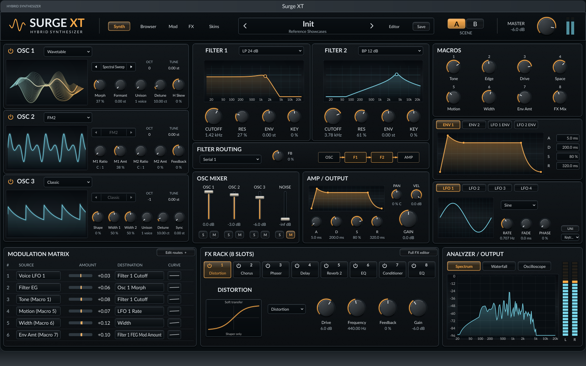
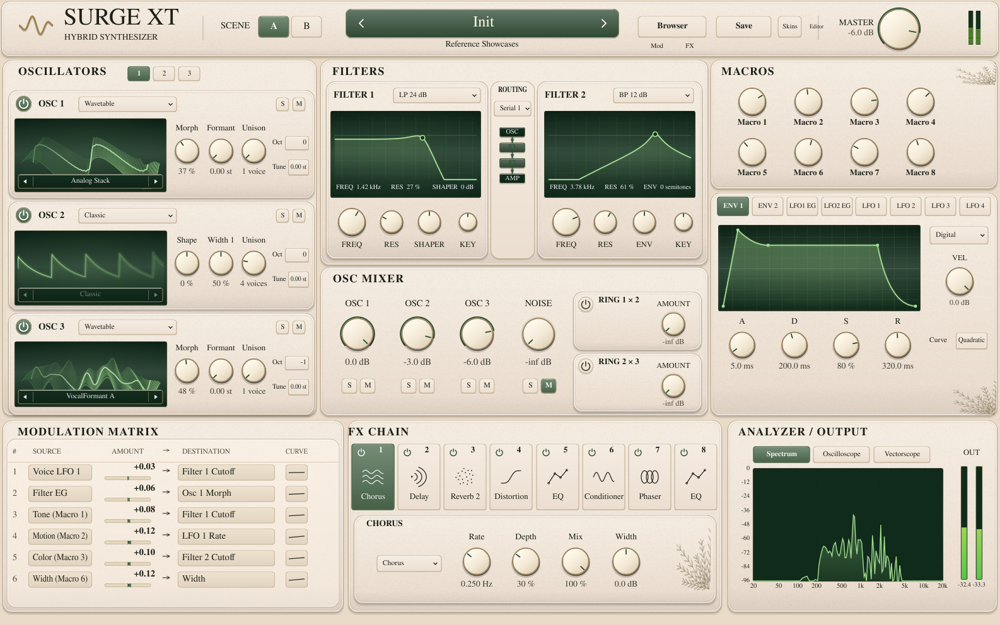
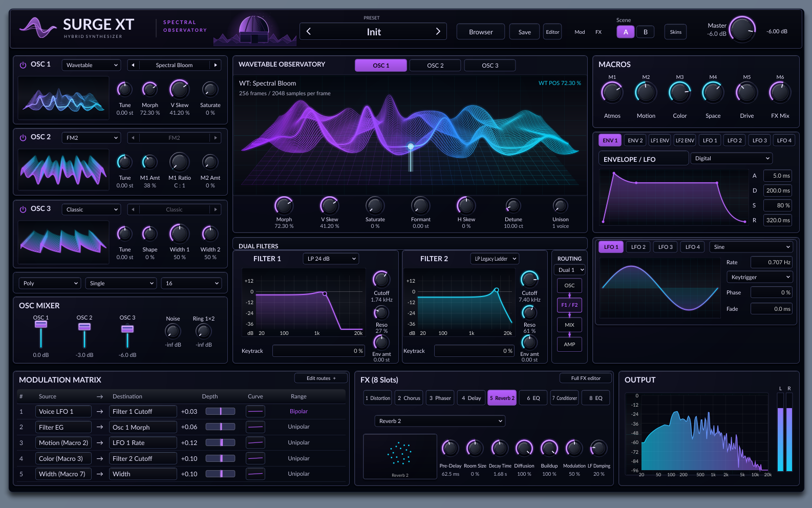
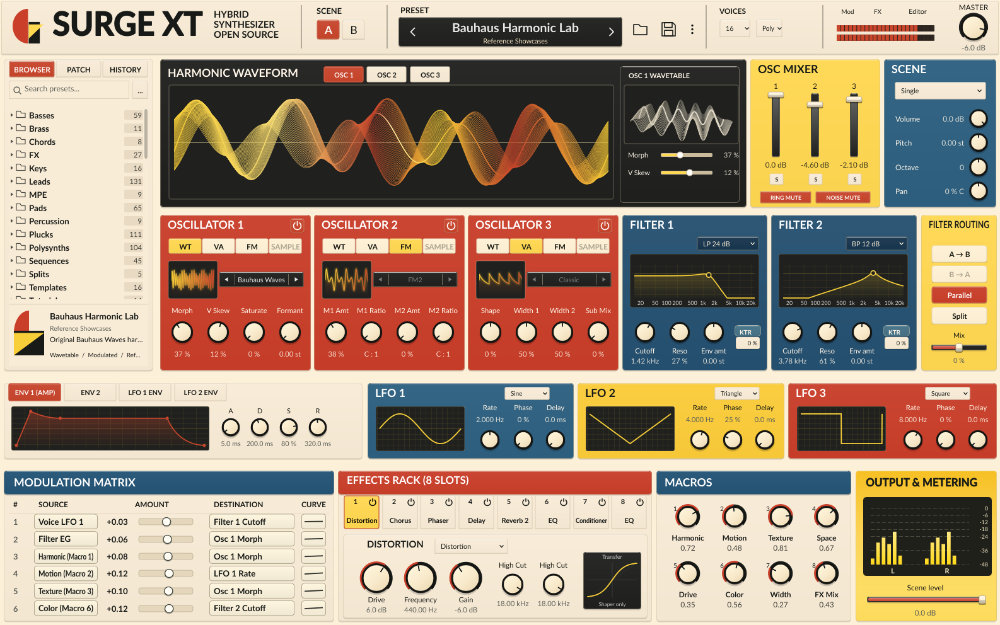
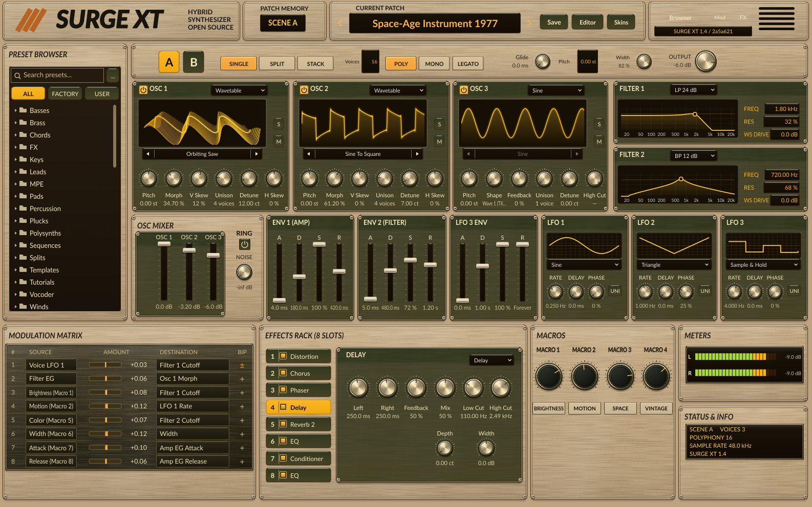
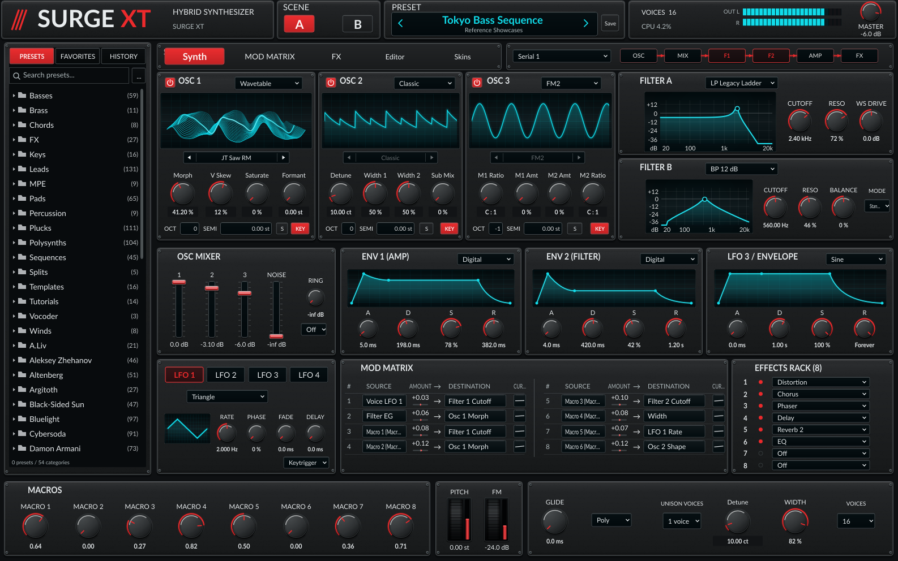
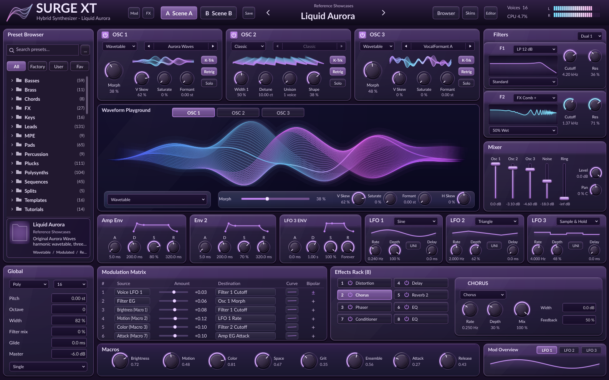
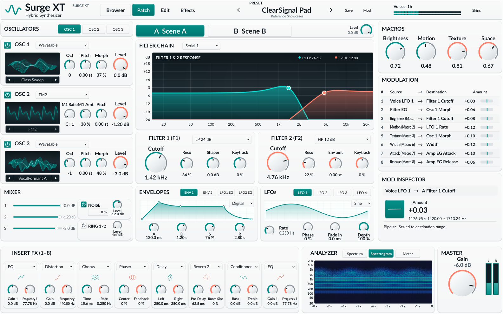
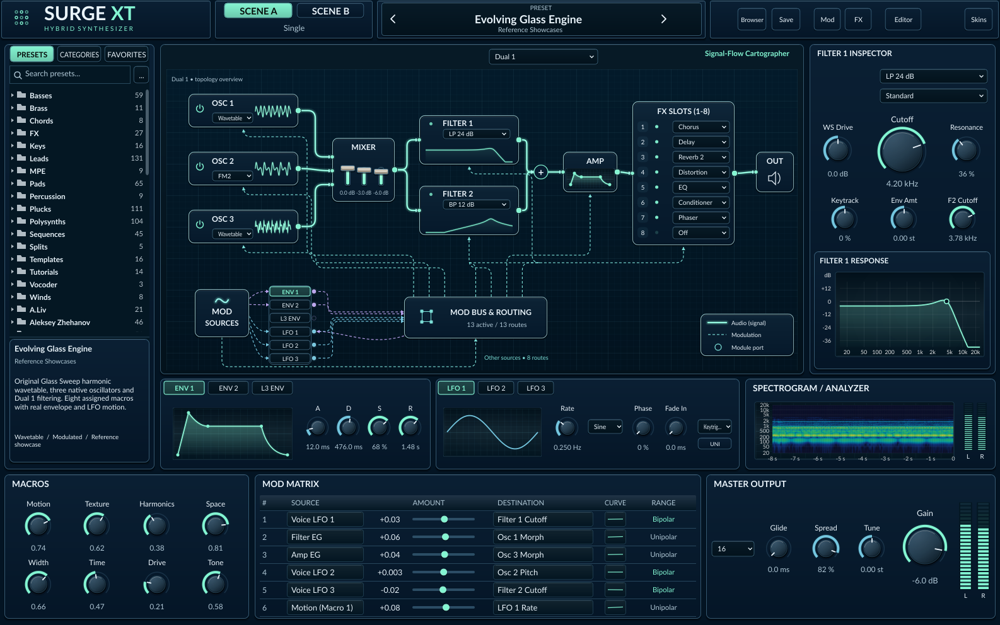
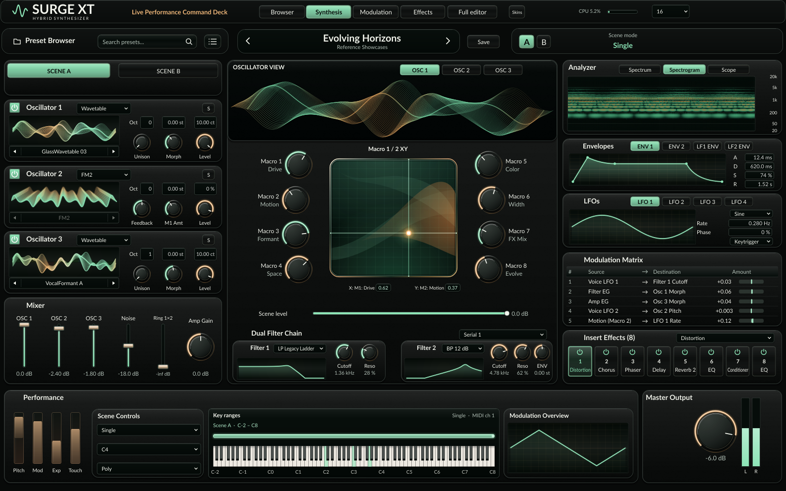

# Native screenshot gallery

Twenty unmodified native PNGs: a baseline and a real edited state for each of the ten skins.
Each image is 1586 × 992 pixels.

**Source:** [2a5a621241e28e15eda57ff5be3bad6dc3f36ff3](https://github.com/tomasedisonn80/surgeXT-synth/commit/2a5a621241e28e15eda57ff5be3bad6dc3f36ff3)  
**Native verification:** [workflow run 43491379963](https://github.com/tomasedisonn80/surgeXT-synth/actions/runs/43491379963)  
**Capture time:** 2026-11-13T19:25:20.801Z

Behavior: 43 cases / 10,317,666 assertions. Capture: 24,100,990 assertions. Normal and ThreadSanitizer audio-display checks passed.

[Open the comparison HTML](index.html) after downloading this directory with its sibling references directory. This README also renders the native gallery directly on GitHub.

[Capture evidence](capture-evidence.json) · [Build provenance](build-provenance.txt) · [Image hashes](gallery-manifest.json) · [Native control guide](../../reference-workspaces-user-guide.md)

Native JUCE component snapshots attached to the actual Surge XT processor. These are not OS desktop or DAW captures. Reference concepts and edited native states are labelled separately. Passing functional tests does not establish pixel-identical reference fidelity.

| Skin | Reference concept | Native baseline | Native edited state |
| --- | --- | --- | --- |
| 01 Obsidian Precision | [Reference](../references/01_Obsidian_Precision.png) | [Native](01-obsidian-precision.png) | [Edited](01-obsidian-precision-edited.png) |
| 02 Ivory Atelier | [Reference](../references/02_Ivory_Atelier.png) | [Native](02-ivory-atelier.png) | [Edited](02-ivory-atelier-edited.png) |
| 03 Spectral Observatory | [Reference](../references/03_Spectral_Observatory.png) | [Native](03-spectral-observatory.png) | [Edited](03-spectral-observatory-edited.png) |
| 04 Bauhaus Modular | [Reference](../references/04_Bauhaus_Modular.png) | [Native](04-bauhaus-modular.png) | [Edited](04-bauhaus-modular-edited.png) |
| 05 Space-Age 1977 | [Reference](../references/05_Space_Age_1977.png) | [Native](05-space-age-1977.png) | [Edited](05-space-age-1977-edited.png) |
| 06 Tokyo Industrial | [Reference](../references/06_Tokyo_Industrial.png) | [Native](06-tokyo-industrial.png) | [Edited](06-tokyo-industrial-edited.png) |
| 07 Liquid Aurora | [Reference](../references/07_Liquid_Aurora.png) | [Native](07-liquid-aurora.png) | [Edited](07-liquid-aurora-edited.png) |
| 08 ClearSignal Accessible | [Reference](../references/08_ClearSignal_Accessible.png) | [Native](08-clearsignal-accessible.png) | [Edited](08-clearsignal-accessible-edited.png) |
| 09 Signal-Flow Cartographer | [Reference](../references/09_Signal_Flow_Cartographer.png) | [Native](09-signal-flow-cartographer.png) | [Edited](09-signal-flow-cartographer-edited.png) |
| 10 Live Performance Deck | [Reference](../references/10_Live_Performance_Deck.png) | [Native](10-live-performance-deck.png) | [Edited](10-live-performance-deck-edited.png) |

## 01 Obsidian Precision

[Reference concept](../references/01_Obsidian_Precision.png) · [Native after editing filter1.cutoff](01-obsidian-precision-edited.png)

## 02 Ivory Atelier

[Reference concept](../references/02_Ivory_Atelier.png) · [Native after editing filter1.cutoff](02-ivory-atelier-edited.png)

## 03 Spectral Observatory

[Reference concept](../references/03_Spectral_Observatory.png) · [Native after editing filter1.cutoff](03-spectral-observatory-edited.png)

## 04 Bauhaus Modular

[Reference concept](../references/04_Bauhaus_Modular.png) · [Native after editing filter1.cutoff](04-bauhaus-modular-edited.png)

## 05 Space-Age 1977

[Reference concept](../references/05_Space_Age_1977.png) · [Native after editing filter1.cutoff](05-space-age-1977-edited.png)

## 06 Tokyo Industrial

[Reference concept](../references/06_Tokyo_Industrial.png) · [Native after editing filter1.cutoff](06-tokyo-industrial-edited.png)

## 07 Liquid Aurora

[Reference concept](../references/07_Liquid_Aurora.png) · [Native after editing filter1.cutoff](07-liquid-aurora-edited.png)

## 08 ClearSignal Accessible

[Reference concept](../references/08_ClearSignal_Accessible.png) · [Native after editing filter1.cutoff](08-clearsignal-accessible-edited.png)

## 09 Signal-Flow Cartographer

[Reference concept](../references/09_Signal_Flow_Cartographer.png) · [Native after editing filter1.cutoff](09-signal-flow-cartographer-edited.png)

## 10 Live Performance Deck

[Reference concept](../references/10_Live_Performance_Deck.png) · [Native after editing filter1.cutoff](10-live-performance-deck-edited.png)
